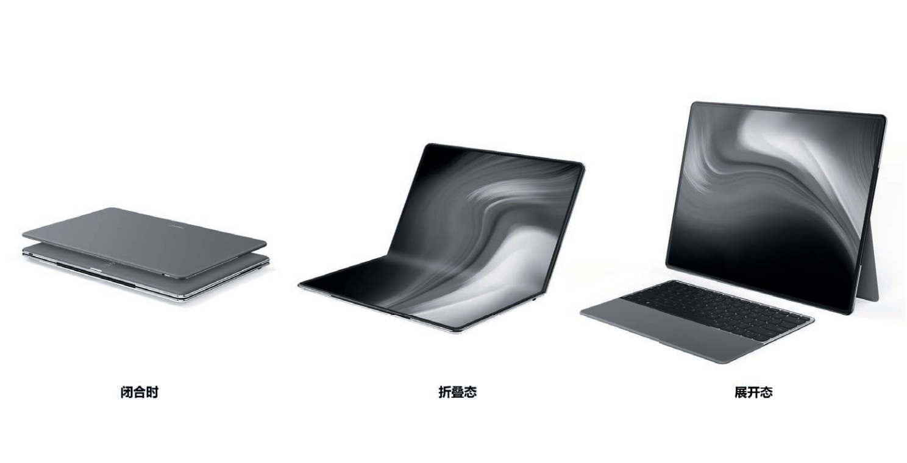
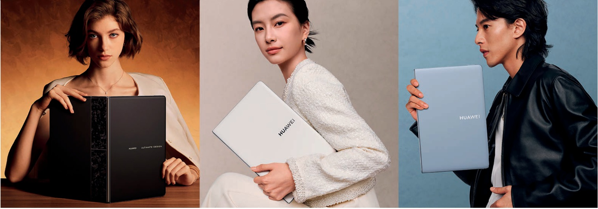
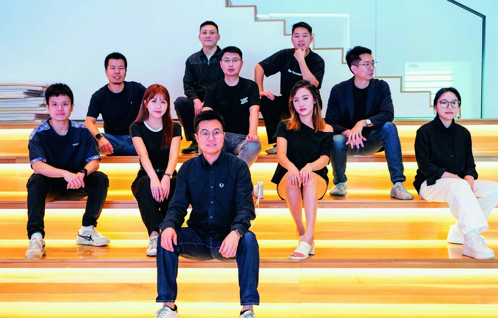
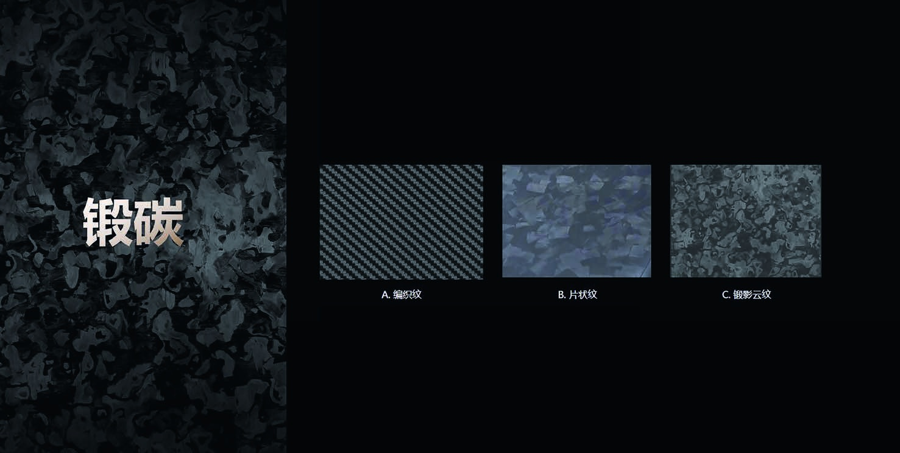
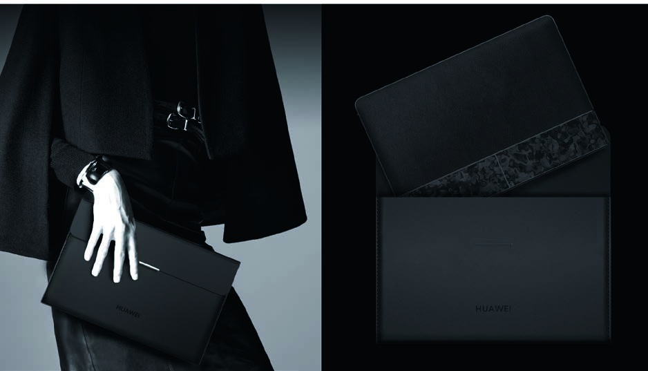
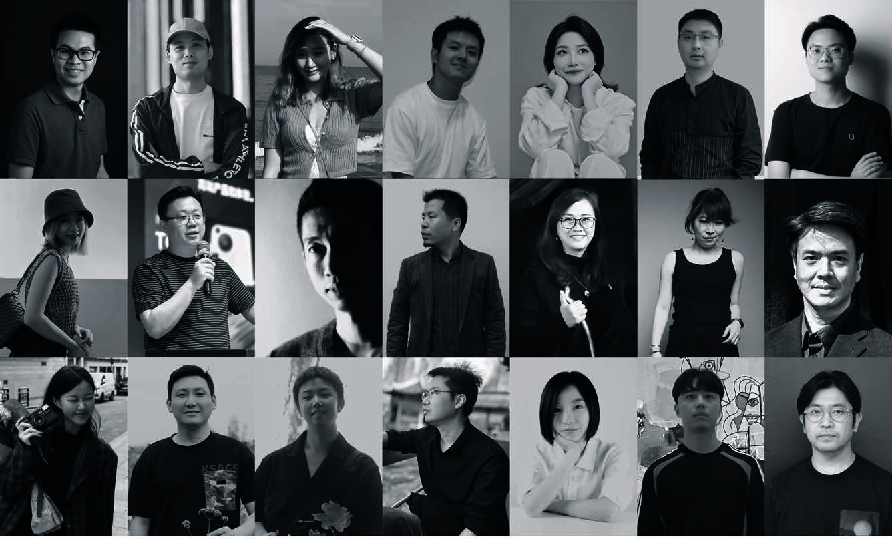

# 用设计定义未来 PC ——对谈 HUAWEI MateBook Fold 主设计师 Duncan Liang

> 文｜《华为人》编辑部

> 原文链接 | https://www-file.huawei.com/admin/asset/v1/pro/view/ec72c66222c849b9a62d6f43caa4222b.pdf

> 整理 | 雪松Cedar，2026-11-06

2025 年 5 月 19 日，首款鸿蒙旗舰折叠屏 PC（个人计算机）——HUAWEI MateBook Fold 惊艳亮相。

“我们希望把不可能变成可能，以创新设计打造真正高端、有品牌价值的产品，一款用设计定义未来的 PC。”HUAWEI MateBook Fold 的主设计师 Duncan Liang 说：“这是一款经过千锤百炼的产品，不同于以往产品设计平均 1 至 2 年的周期，它的诞生用了六七年时间。当所有条件准备好时，一个伟大的作品才会诞生。”

作为华为旗舰 PC 的 ID（工业设计）设计师，他想要创造一种突破传统形态的 PC 设计，让设计驱动产品创新。让我们听他讲述 HUAWEI MateBook Fold 背后的设计故事。

## 01 创新：打破常规，重构规则

**问：** 您能和我们分享一下关于这款创新形态的 PC，最初想法是怎么来的吗？

**Duncan：** MateBook Fold 的原型设计在 2018 年就诞生了。当时华为进入 PC 领域不久，但我们已经开始思考和探讨未来的 PC 应该长什么样。如果有一天搭载上华为自己的操作系统，又会是什么样？放眼望去，市场上是清一色的传统 PC，消费者似乎也习惯了 PC 就是长这个样子。我们能否有突破传统形态的 PC 设计，在茫茫的 PC 消费市场中脱颖而出，成为高端品牌，吸引更多的高端消费者？这是 ID 前置引领创新、定义价值的重要性。我们希望在打破常规、重构规则的路上前行，不断打磨新的设计。

2018 年，主管提出了一个命题：可不可以重新定义便携 PC？经过深思，我想用折叠形态打造超便携产品：屏幕足够大，超越目前市场上所有的 PC，提供更沉浸的显示体验；产品体积非常小，甚至比现有的 PC 都要小，易于携带，是一款可以装进通勤包的、随身携带的一体机 PC。

我们开展了很多次研讨，尝试了不同的折叠设计方案，摆脱传统 PC 厚重、不够时尚、不够科技的固有工具属性，致力于打造极致、轻薄的设计，提出了“大屏便携”概念，让消费者在出差等移动场景下更愿意携带，更便捷地使用。

**问：** 它第一次亮相是什么时候？大家的评价如何？

**Duncan：** 那不得不提到工业设计部每年都举办的 Design Show（设计展），它是工业设计部和平板与 PC 产品线相互沟通与合作的桥梁。在 Design Show 上，我们针对不同的 PC 品类提出创新的产品概念设计，并通过具象化、可视化的实物手板，甚至制作原型功能机来真实呈现。所有设计师都可以敞开想象力，敢于做最佳的产品，做极致的产品。产品线和我们共同畅想未来设计，寻求最具投资价值的产品。

2019 年的 Design Show 上，日本设计团队的内置支架设计激发了我们创新的小火花。经过一年多的设计打磨，创新形态的折叠 PC 原型设计一亮相就成了焦点。纤薄的设计大胆超前，时尚高端的 CMF（颜色、材料及表面处理）非常惊艳。产品线认为，我们通过创新设计，将“一体机”电脑的“大屏”和笔记本电脑的“便携”结合起来，创造了一个“人无我有”的全新产品。当然，当时还没有鸿蒙电脑这一概念，但我们相信未来有一天它可以实现。

随之而来的有两个“灵魂拷问”：消费者真的需要折叠 PC 产品吗？屏幕技术、转轴、工艺材料等技术是否成熟了？从 2020 年到 2021 年，我们一直在研讨和探索回答这两个问题。同时，不断完善屏幕、产品使用体验、键盘等配件的设计细节和交互方式。

2022 年，折叠 PC 的产品化终于提上日程。看到我们做出具有创新体验的折叠形态 ID 手板时，时任终端 BG CEO 余承东、终端 BG COO（首席运营官）何刚以及产品线领导都觉得它非常有竞争力，坚定地表示要做出来。

*MateBook Fold 原型设计：更大视野、更便携的体验。由左至右：闭合态、折叠态、展开态。*

## 02 超越笔记本的大视野，带来更便携的体验

**问：** 在产品设计阶段，你们认为这款产品的目标人群是谁？

**Duncan：** 在设计开始之前，我们不断问自己：这款产品的目标人群是谁？他们是什么样的人，喜欢什么，过怎样的生活？考虑到这是一款定位高端又带有鲜明个性的产品，我们将目光聚焦在三类人群身上：高端用户、科技尝鲜者、时尚达人。他们的审美喜好和生活方式，为我们的设计提供了清晰的方向。我们尝试用 CMF 去讲述这三种不同的生活方式：

*MateBook Fold CMF 设计：锻影黑、天际白、云水蓝。*

对高端用户而言，产品不仅是工具，更是品位的延伸。他们不追求浮夸，偏爱内敛，讲究质感和长期价值。我们为他们打造了“锻影黑”——深沉、克制，像一套剪裁得体的高级西装。63 道精工工艺打磨出的自由云纹，在低调中流动出高级光感。这种黑，不是张扬的惊艳，而是值得细细品味的经典，如他们的生活：安静，却极致讲究。

对于科技尝鲜者来说，他们总是走在最前沿，哪里有新潮，哪里就有他们的身影。我们为他们设计了“云水蓝”。灵感来自清晨破晓的第一道光，轻盈、纯净，又充满力量。它不仅象征着科技的理性和探索精神，也带着一丝未来感，是属于先锋者的信号色。

至于时尚达人，他们对设计有着天然的敏感，总在寻找能表达自我态度的美学语言。我们为他们呈现“天际白”，一种干净却不单调的白，像高空的云、像舞台的光。它的优雅中带着一丝锋锐，是视觉的焦点，也是一种风格的宣言。

三类人群，三个 CMF 设计，三种生活方式。我们相信，每一个人都能找到与自己共鸣的那一款——因为设计，从来不止是“做得好看”，而是“看得见你是谁”。

**问：** 您能谈谈定义创新的过程吗？比如，为什么采用 18 吋的屏幕？

**Duncan：** 在项目设计推敲的过程中，最大的难点在于怎么将折叠产品做到超便携。折叠真正的价值是产品“可大可小”，而留给我们“大”的想象空间其实很多。

既然做，我们就渴望做全世界最大的屏幕，同时带给用户最便携的体验。因为设计不是做技术规格的堆砌，而是从体验出发，深入洞察用户真正的需求——要折叠、要便携、要足够大的屏幕，显示体验比目前的 PC 更好。

纵观市面上最大的 PC 尺寸只有 16 吋，那我们就做更大的尺寸。17 吋、18 吋、19 吋、20 吋……我们一一制作各种满足大屏需求的手板。你可以想象这个画面，一张长桌上摆满各种比例的草模，非常壮观。每个草模上打印不同的模拟交互界面，大家可以实际感受不同场景下各种屏幕尺寸和比例的交互体验，以及可能遇到的问题。

19 吋和 20 吋满足了大屏的需求，但很难携带。随着屏幕尺寸加大，结构件重量以及电池容量提升等也增加了整机的重量。而且，折叠后面积太大，不能轻易地放进通勤包内。因此，最后我们把眼光锁定到展开尺寸 18 吋、折叠尺寸 13 吋，比一张 A4 纸小，也比我们最热销的 PC 小，达成了大屏、便携、体验的最优解。

我们认为它的核心产品形态有两个：大屏模式和笔记本模式。笔记本模式下的屏幕显示比例，我们采用了 3:2 设计，是理想的办公体验方式；大屏展开后的比例为 4:3，平衡了屏幕显示和便携之间的关系。

## 03 追求极致，向美而生

**问：** 产品开发一定不是一帆风顺的，你们如何处理过程中的分歧？

**Duncan：** 是的，在追求极致的路上，总会遇到不止一个难题。在折叠 PC 项目初期，项目组内部有一种观点——希望最大限度地展示折叠形态的多样性。除了常规的大屏态和笔记本态，还提出要强调竖屏、书本、扩展等形态场景，以体现“全能”的产品印象。但我们坚持认为：设计要聚焦，核心体验才是关键。过多强调各种形态，不但会削弱用户对产品主张的认知，还会让人迷失在“到底该怎么用”的困惑中。更关键的是，这将直接影响到产品支架的设计决策：到底是做内置支架还是外置支架？

从 2018 年 ID 原型概念设计，到 2021 年项目立项，再到 2022 年的原型工程机验证，四年的时间，原型机“内置支架”的设计是否合理，一直被质疑、讨论和挑战。

如果强调产品多样的变形形态，突出的是产品的多样性，说明对灵活性诉求更高，外置支架就会更合适。如果大屏是核心场景，说明支架使用频率高，支架内置就很有必要。

我们深入分析了用户使用折叠电脑的不同场景，如办公场景，包括文档、会议、手绘等工作流；娱乐场景，包括电影、电视直播等；浏览场景，包括新闻浏览、书籍阅读、购物……针对这些不同的场景，我们做出带有真实场景图片的草模，让大家在没有实际真实屏幕的情况下，快速感受交互体验。而后，我们对各场景下不同形态的使用次序排序，以系统的方式证明了核心场景和主要形态，从而论证了内置支架的正确性。

之后，我们与 2012 实验室的设计师和结构专家、终端的架构设计师和结构设计师等紧密配合，解剖产品空间堆叠，实现了看似“不可能的平衡”——既保留了轻薄优雅的设计感，又提供了稳定可靠的支撑体验，还能实现多角度无级自由悬停。

支架的设计是形式与功能的美妙结合，体现出我们对极致美学、极致体验的追求。另外，我们还有一个小巧思，从外观上看，它像一个“H”，既代表了华为的“H”，也代表了全新 HarmonyOS 鸿蒙系统，具有高辨识度，是一个能够被消费者记住的设计特征。

*团队合照（第一排为 Duncan Liang）。*

**问：** 这款产品的外观采用了 PU（聚氨酯）素皮材质，是出于什么样的考虑？

**Duncan：** 原型设计完成后，我们开始思考产品的 CMF 方向。市面上的 PC，要么是金属，要么是塑胶，材料和视觉语言都趋于同质化。我们希望不仅在产品形态上有所突破，更要在材质表达上打破沉闷、重塑高级感。铝合金虽然有科技感，但太常见，难出新意；玻璃和陶瓷质感上乘，却因重量和易碎性无法大面积应用……我们最终锚定了一个从未被用在华为 PC 上的材料：PU 素皮。

基于“超越 PC 的大视野、更便携的体验”这一核心理念，我联合工艺专家和 CMF 设计师启动功能验证和视觉探索，并迅速完成第一轮 ID 手板。但没想到，质疑声几乎在第一时间就汹涌而来——

> “皮革材料给人的感觉太老气了，一点都不高端，不时尚。”
>
> “皮料不耐磨，很容易磨损。我不同意。”
>
> “它会不会像表带一样，使用一段时间后发出难闻的气味？”
>
> “我们既要在笔记本态时确保耐磨可靠，又要在大屏态时产品背面美观完整，看不到脚垫补丁，怎么可能呢？”

面对质疑，提供清晰的分析和可靠的证据是有效的回应方式。我们一方面从高端奢侈品、豪华汽车中汲取灵感，通过皮料的纹理、颜色、光泽以及与金色材质的相互搭配，实现了既尊贵高端、又时尚年轻的视觉印象。另一方面，我们四处寻找资源，尝试各种工艺技术方案，从皮料的叠层设计、表面处理方案、树脂配方成分以及贴合胶水、测试方案等各个维度着手，不断推演，持续打磨，对每个细节“死磕到底”……

为了验证材料的真实耐用性，我们反推出 PC 典型使用周期下的老化性能标准，对照现有材料，找出差距，并联合供应商定制树脂配方，逐项对比验证。我们甚至将不同样本贴在自己的电脑底部进行使用实测。

然而，新问题又出现了：材料的老化测试需要 35 天，无法满足项目的快节奏。为此，我们联合工艺专家和实验室提出“新的老化模拟加速法”，压缩测试周期至一周，大幅提升开发效率。经过半年多的努力，通过对树脂配方及表面处理的突破性优化，最新的素皮材料耐磨性能更强、更可靠，同时手感更加温润舒适。

当周边领域的同事看到那块经过高强度测试后仍保持出色外观的素皮样品时，不再有质疑，只有由衷的认可。这也让我看到，突破刻板印象很困难，但我们总能找到出路。

## 04 一画开天，锻造非凡

**问：** MateBook Fold“非凡大师”在锻影黑版本的背面设计上与其他两款有所不同，你们是怎么思考的？

**Duncan：** MateBook Fold 是平板与 PC 产品线第一款承载高端“非凡大师”品牌的产品，代表了最高端、最独特、最创新的设计理念。什么是高端呢？我们认为，全新的形态、全新的设计、全新的体验、全新的技术，可以带来人无我有的、稀缺的、不可复制的高端感受。在全新的 MateBook Fold 产品中，有一个版本是最经典的——全新锻影黑。以往 PC 都采用铝合金材料外观，但这一次，我们选择了一条从未走过的路。

为了打造一款真正独特的高端 PC，我们首次采用了目前高端的轻量化材料锻碳。这在华为 PC 设计中，是一次全新的突破。但真正的挑战，并不止于材料本身，而是：如何通过纹理设计，让这款新材料呈现出高端、独特的质感？

一开始，我们尝试了最基础的碳纤维编织纹理效果，但它太常规，市面上类似的产品太多，无法脱颖而出。我们还尝试了工艺难度大一点的片状纹理，却显得零散、生硬，缺少灵动性与高级感。最后，我们决定采用更自由流动的“云”纹理，打破传统的边界，呈现出一种高级内敛、深邃光影、极具格调的视觉体验。接下来的日子里，我们辗转于材料厂、手板厂、模具厂，围绕纹理的每一个细节，从材料叠层、成型方式到表面工艺和最终手感，与供应商进行了深入讨论与反复试验。这是一个漫长且充满不确定的过程，我们无数次否定自己，只为接近那个“最合适的答案”。

为了在决策汇报前拿出理想的效果，我和另一位旗舰电脑设计师连续几晚驻扎在手板厂，与产线师傅们一起反复调试、验证细节。当终端的领导与专家看到最终手板时，现场气氛一下子被点燃了。大家一致认可了这套设计的高级感与独特性，当场决定以“非凡大师”之名发布 MateBook Fold。

这不仅是对我们设计成果的认可，更是对团队极致追求的肯定，也为 PC 产品线注入了信心和力量。

*锻碳的三种形态：A 为编织纹，B 为片状纹，C 为锻影云纹。*

**问：** 您能分享一些从设计想法到产品实现过程中的故事吗？

**Duncan：** 做出样品，只是万里长征的第一步。要实现量产，必须解决外观复现、精致度以及良率等问题。业界的锻碳产品对厚度没有苛刻的要求，叠层设计后锻压成型，再进行表面加工就完成了。但在极薄的基材上实现自由流动的云纹效果，这是业界没做过的，对工艺的挑战巨大。

刚开始，锻碳在加工后效果没有云状，有时候呈现碎片状，有时候呈现发丝状。为此，我们半年内跑遍全国十多家华为合作的上下游厂商，将裁切、锻造、精雕以及拓印等全部 63 道工序逐一拆解，从原材料的管控到模厂生产，再到贴合组装，定义每一道工序的具体参数。

试制、测试、总结、改进、再试制，我们每天与供应商开会讨论改进方案，一次又一次推翻再确定，用九个多月时间解决了资源能力问题，大大提升了生产质量、良率和效率。这也让我深刻感受到，非凡始于平凡。每一个日夜的坚持，每一份匠心的打造，成就了“非凡大师”。在这个过程中，离不开项目组每一个成员的付出，以及平板与 PC 产品线对极致设计的支持。

**问：** 我们注意到，“非凡大师”的配件设计也很有特点？

**Duncan：** 我们坚持主机和配件遵循统一的调性，统一的体验，统一的设计语言：高端、极致简约、纯净，使之视觉上协调，用户使用时也更流畅自然。

比如，键盘采用了独特设计，这可能是全球最薄的全尺寸键盘。一开始我们就在思考键盘怎么收纳是最便携的，我的第一直觉是，从简约的体验出发，用户只需要把键盘往主机的背面一吸即可，一拿即走。说起来容易，做起来非常难。吸力要多少才合适？吸得太紧不好拿下来，吸得太松又容易脱落。我们和架构工程师、结构工程师开了无数次会，还专门跑去磁铁厂，调研不同磁铁的规格、布置，进行吸力测试，精确到每一个细节。

再来说说收纳包的设计吧，越是简洁的设计，背后越是复杂。我们联合了 2012 实验室设计团队和巴黎美学研究所，花了两年时间精雕细琢：从外料到里料，从经线到磁吸开合，每一处都尝试了无数方案——平面的、翻折的、拉链的……能想到的我们几乎都做了。做出样品后，我们发现太重了，不符合我们对“轻薄便携”的定义。我们重新出发，设定挑战目标：把收纳包的重量控制在 200 克以内。为了达成这个目标，我们深入工厂的每一个材料中，每一道工序中——用天平称重每一件材料，皮料、磁铁、胶水等，每一克都不放过。供应商当时都震惊了，说从来没见过这么“抠”细节的客户。

*华为折叠电脑尊享收纳包。*

但我们相信，真正极致的产品，背后一定是极致的坚持。看似微不足道的细节，却能让消费者在使用的某个瞬间感受到我们的用心。

## 05 展望未来：给消费者带来更多创新体验

**问：** 您如何看待用这么长时间来做这么一款产品？

**Duncan：** 这是一个蛮有挑战的项目，我们用了很长时间来打磨产品，我白头发都长出来了。但同时，这又是一个可遇而不可求的机会——用设计引领创新，创造了一个全新的产品形态，开辟了一个全新的赛道。它丰富了华为智慧办公产品品类，无论对公司还是我个人来说，都非常有意义。最近，MateBook Fold 还获得了被誉为“设计奥斯卡”的 iF 设计奖，让我们备受鼓舞。

工业设计有自己最独特的价值，始于颜值，终于体验。无论是产品设计还是交互方式，我相信，消费者都能够感知到我们的用心之处。

**问：** 作为设计师，你们怎样保持对创新的敏感度？

**Duncan：** 拥抱技术，让自己一直处于热血澎湃的状态，时刻保持对美的追求。设计是一段既富有创造性，又充满挑战的旅程，设计师的内心都有一种追求：敢于定义，敢于突破，敢于实现。我们渴望做出“别人想不到的产品、能想到但做不到的产品，甚至是不敢想的产品”，用感动人心的设计，创造伟大产品，让生活美而简单！

*MateBook Fold 工业设计团队。*
